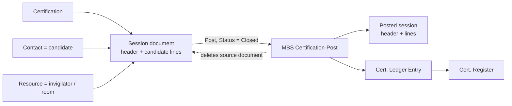

# MBS Certification Session Management

A Microsoft Dynamics 365 Business Central **Per-Tenant Extension (PTE)** demo for planning certification sessions, recording candidate outcomes, posting immutable history, and tracking attempt data. Built on the [AL-Go for GitHub](https://aka.ms/AL-Go) PTE template as four AL projects: the main app, a test app, a dataset app, and a performance test app.

## Problem

Training and certification teams run exam sessions with spreadsheets and email: who sat which certification, in which room, under which invigilator, with what result, and on which attempt. Retakes and pass rates are hard to answer reliably.

Who it serves:

- **Certification Coordinator** - maintains certifications and schedules sessions
- **Invigilator** - runs the session and records attendance and results
- **Training Manager** - reviews outcomes and retake history

## Why this matters

- **One system of record** for planned sessions, results, and immutable history, queryable by certification, candidate, and attempt.
- **Native BC pattern:** setup, master data, document, posting, posted document, ledger entry, and register, using Contacts as candidates, Resources as invigilators and rooms, No. Series, and Source Code Setup.
- **Partner reuse:** a second reference for the AL-Go four-project layout, derived from the proven *MBS Site Inspection Scheduling* demo.

## Architecture

**Business Central scope.** Setup table, certification master data, a session document (header and candidate lines), a posted-document pair, a certification ledger with registers, and comment lines shared by certifications, sessions, and posted sessions. Standard objects used: `Contact` (candidate), `Resource` (invigilator = Person, room = Machine), `No. Series`, and `Source Code Setup` (extended with a *Certification* source code, `MBSCERT`, created by the install codeunit).

**Flow.** Posting a closed session validates the header and lines, assigns a posting number, creates the posted header and candidate lines, copies comments, writes one ledger entry per candidate and updates the register, then **deletes the source document**.

**Boundaries.**

- Everything stays inside Business Central: no APIs, events, external services, or AI, Power Platform, or Azure integration.
- Security: one assignable permission set (`MBS Cert. All Users`, 50000). Tables and posting codeunits are `Access = Internal`; the companion apps are granted access through `internalsVisibleTo`.
- Target: `Cloud` (SaaS), platform and application `28.0.0.0`, runtime `17.0`.

See [`App/README.md`](App/README.md) for the full object reference.

## Demo steps

**Prerequisites:** a Business Central 28.0+ sandbox with the **App** project published.

1. Open **Certification Setup** and assign the three number series.
2. Open **Certification List** and create certifications.
3. Open **Cert. Session List**, create a session, and pick the certification, session date, invigilator, and room.
4. Add candidates, record attendance, result status, and score.
5. Set the status to **Closed** and post.
6. Verify under **Posted Cert. Sess. List**, **Cert. Ledger Entries**, and **Cert. Registers**.

**Optional demo data:** publish **App.Dataset** (requires Microsoft's Contoso Coffee Demo Dataset), open **Contoso Demo Tool**, select the *Certification Session Management* module, and run generation. See [`App.Dataset/README.md`](App.Dataset/README.md).

**Tests and performance:** see [`App.Test/README.md`](App.Test/README.md) and [`App.PerformanceTest/README.md`](App.PerformanceTest/README.md).

## What is intentionally simple

- Single permission set and a single ledger entry type (*Registration*).
- No reports, APIs, role center, or extension events.
- No telemetry.
- Demo-scale data: a handful of certifications, invigilators, rooms, and candidates.
- Demo-grade tests and BCPT scenarios, not an exhaustive suite.

## Risks/limits

- **Not production-ready.** A demo intended to showcase AL-Go and modern AL practices. Not an officially supported Microsoft product.
- **Immutability is enforced by permissions and page settings only.** Posted and ledger pages are read-only and the permission set grants only RI on posted and ledger data, but the tables have no modify or delete guards. Test permissions are disabled in the test app, so tests do not prove this.
- **No role separation.** All personas share one permission set.
- **Status transitions are not enforced.** The only rule is that posting requires *Closed*.
- **Posting deletes the source document**, its lines, and its comments after copying them to the posted record.
- **Compiler-unverified at hand-over.** The code was written without a compiler in the authoring environment; AL-Go CI is the first build.

## Next iteration

1. Enforce immutability on posted and ledger tables and split the permission set into role-based sets (coordinator, invigilator, read-only reviewer).
2. Enforce status transitions on the session header.
3. Add business events around posting for partner extensibility.
4. Add pass-rate reporting keyed by certification and candidate.

## Repository structure

| Folder | App | Purpose | Object IDs |
|---|---|---|---|
| [`App`](App/README.md) | MBS Certification Session Management | Main extension: tables, pages, posting logic, permission set | `50000..50099` |
| [`App.Test`](App.Test/README.md) | MBS Certification Session Management Test | Automated tests (24 test methods) | `50100..50199` |
| [`App.PerformanceTest`](App.PerformanceTest/README.md) | MBS Certification Session Management Performance Test | BCPT scenarios | `50200..50299` |
| [`App.Dataset`](App.Dataset/README.md) | MBS Certification Session Management Dataset | Contoso Demo Data module | `50300..50399` |

Other folders: `.AL-Go/` and `.github/` hold AL-Go settings and workflows.

## Notes

- **Requirements:** Business Central platform/application **28.0.0.0** or later. The main app has no external app dependencies. `App.Dataset` depends on Microsoft's Contoso Coffee Demo Dataset; `App.Test` and `App.PerformanceTest` depend on Microsoft test and performance libraries.
- **CI/CD (AL-Go):** `CICD.yaml` builds and tests all four apps on push to `main`, `release/*`, or `feature/*`; `PullRequestHandler.yaml` validates pull requests; `Current` / `NextMinor` / `NextMajor` test forward compatibility.
- **License:** [MIT](LICENSE).
